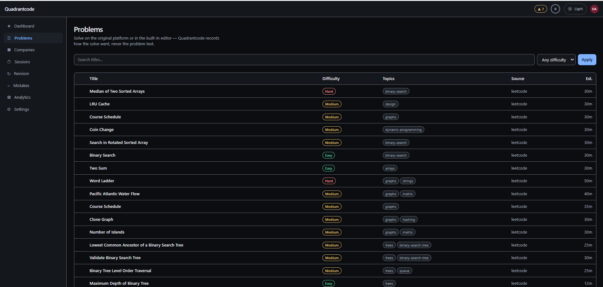
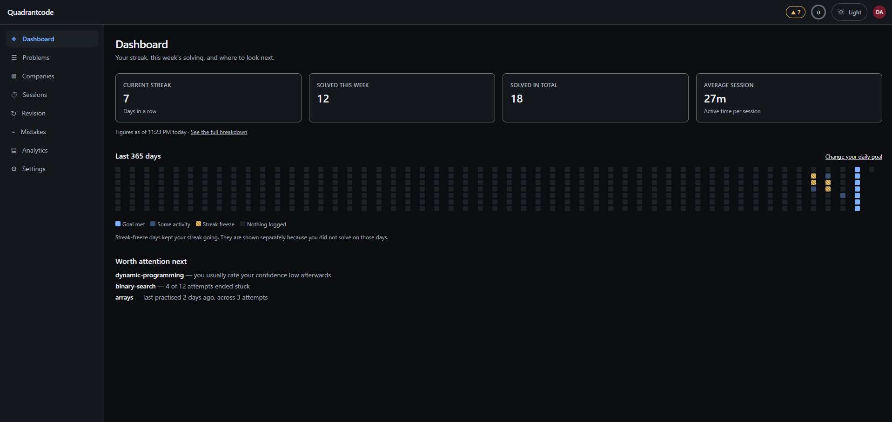
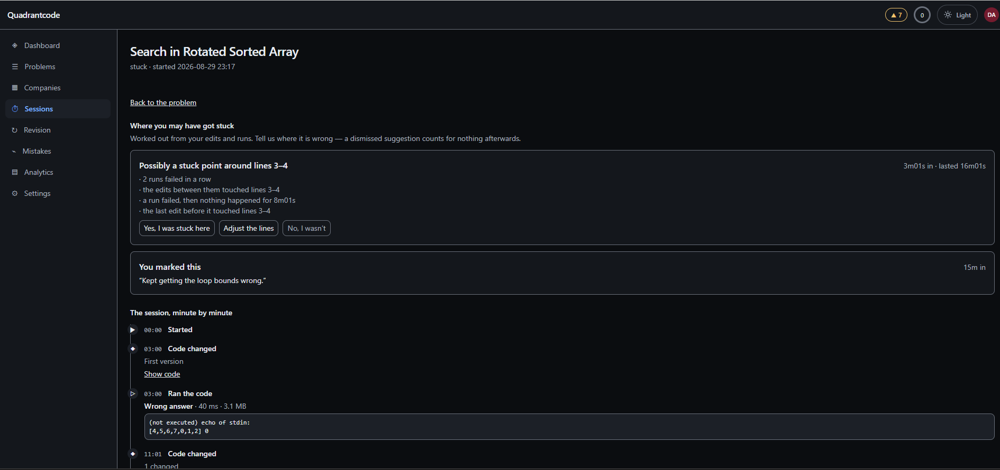
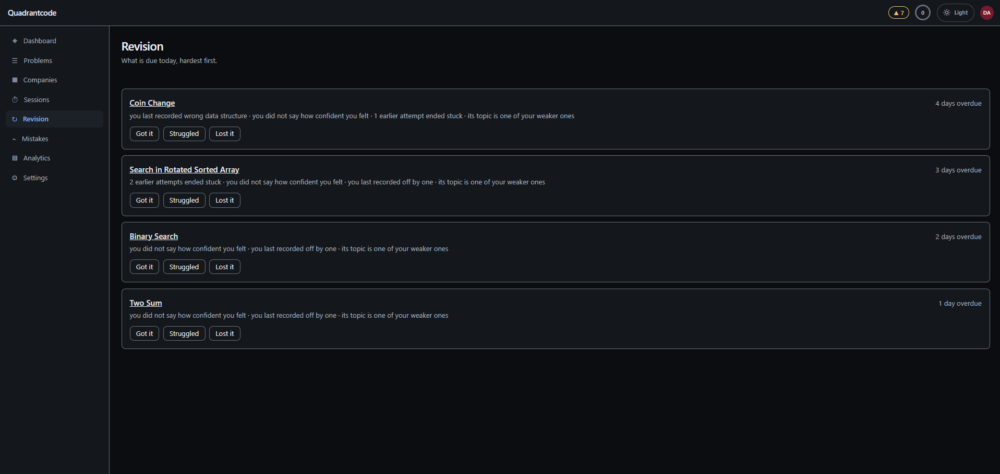
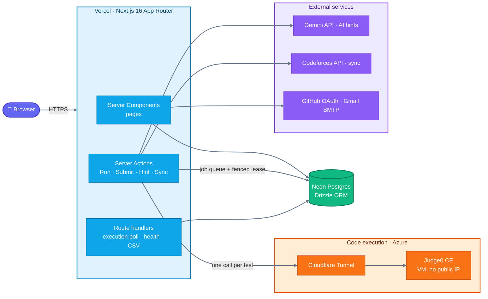
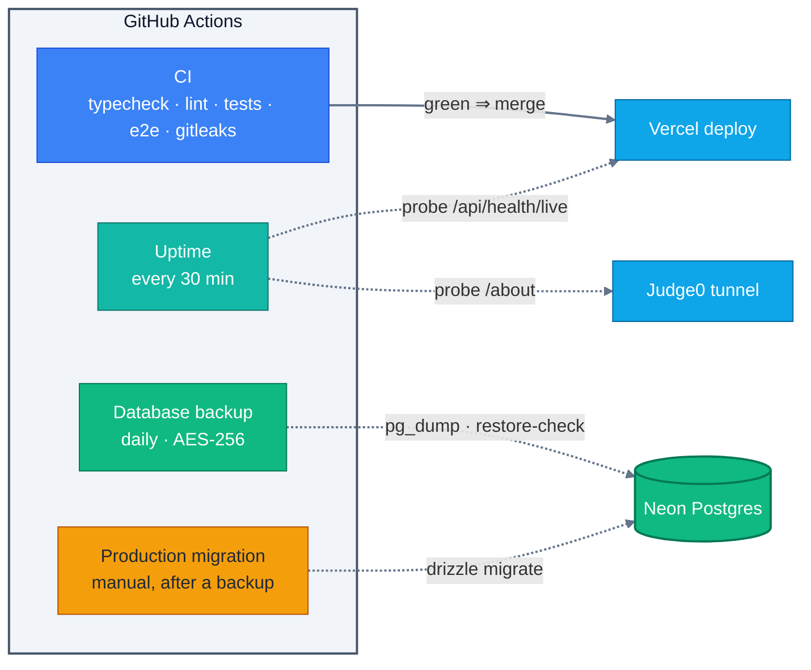
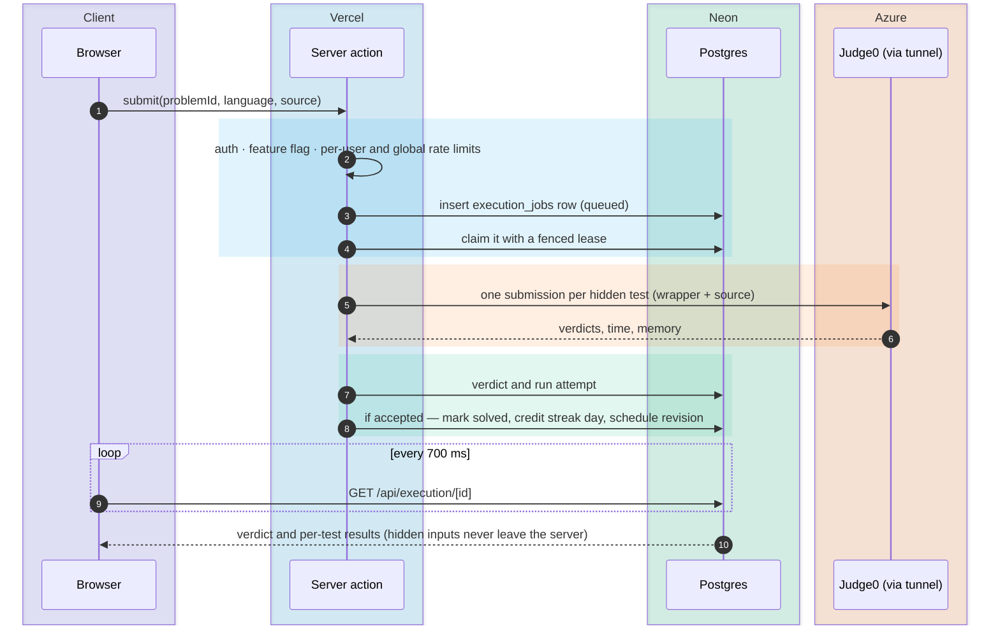
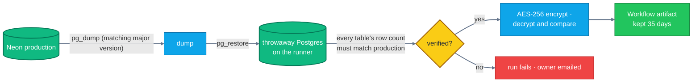

# Quadrantcode

**A DSA practice platform that records _how_ you solved a problem — where you got
stuck, what you got wrong, and what to revise next — not just that you solved it.**

[](https://github.com/vikramyadav1404/quadrantcode/actions/workflows/ci.yml)
[](https://github.com/vikramyadav1404/quadrantcode/actions/workflows/uptime.yml)
[](https://github.com/vikramyadav1404/quadrantcode/actions/workflows/db-backup.yml)


**Live:** [quadrantcode.vikramyadav.me](https://quadrantcode.vikramyadav.me) · sign in with GitHub or an emailed link

|                                                       |                                                     |
| ----------------------------------------------------- | --------------------------------------------------- |
|         |      |
| **Solve** — editor, problem panel, server-owned timer | **Dashboard** — streak, daily goal, activity        |
|   |  |
| **Session** — run attempts, snapshots, stuck points   | **Revision** — what is due, and why                 |

---

## At a glance

|                       |                                                                                         |
| --------------------- | --------------------------------------------------------------------------------------- |
| **Original problems** | 56, each with visible and hidden tests and an editorial, in 5 languages                 |
| **Mock OAs**          | 13 timed papers (easy + 2 medium + hard, 90 min), scored on server-verified submits     |
| **Code execution**    | Self-hosted Judge0 on Azure, reachable only through a Cloudflare Tunnel                 |
| **Tests**             | Vitest against a real Postgres and Playwright in the browser, run in CI on every push   |
| **Database**          | 50 tables, 33 versioned migrations, each with a hand-written down migration             |
| **Operations**        | CI on every push, uptime check every 30 min, daily encrypted backup verified by restore |
| **Decisions**         | Recorded in [`docs/decisions.md`](docs/decisions.md), with the alternatives rejected    |

---

## The problem

You grind a hundred problems, and three weeks later you cannot answer the only
questions that matter: **where did I get stuck, what did I get wrong, and what
should I revise first?**

Judges record an outcome — accepted or not. They do not record the twenty
minutes lost to an off-by-one, or that binary-search bounds have now cost you
four sessions. Quadrantcode records that part, and turns it into what to
practise next.

## Features

| Area                    | What it does                                                                                                                                                       |
| ----------------------- | ------------------------------------------------------------------------------------------------------------------------------------------------------------------ |
| **Solve**               | Monaco editor, Run on visible or custom cases, Submit against the full hidden set — C, C++17, Java, Python 3, JavaScript                                           |
| **Server-owned timer**  | The client sends intent, never a duration; elapsed time is derived from an append-only event log                                                                   |
| **Stuck points**        | Marked by you or suggested by heuristics, and weighted differently                                                                                                 |
| **Reflections**         | A fixed mistake taxonomy, so "what do I keep getting wrong" is a query, not a reread of notes                                                                      |
| **Code snapshots**      | How the solution evolved, kept per sitting                                                                                                                         |
| **Spaced revision**     | A fixed ladder (default) or **FSRS** (opt-in), ordered by a forgetting-risk score                                                                                  |
| **Failing-case finder** | After a failed Submit: which kinds of test failed, and a small generated input your code gets wrong, one click to add it as a test case — hidden tests stay hidden |
| **Mock OA**             | 13 timed papers at `/mocks`; server clock, server-verified scoring, upsolve queue afterwards                                                                       |
| **AI hint coach**       | Three levels per problem — nudge, approach, next step — never a solution (Gemini, opt-in, disclosed)                                                               |
| **Codeforces sync**     | Connect a handle; accepted problems are imported and marked solved through Codeforces' official API                                                                |
| **Import / export**     | CSV in and out, idempotent; LeetCode and HackerRank lists come in this way                                                                                         |
| **Analytics**           | Streak, heatmap, topic strength, recurring mistakes — precomputed rollups, hand-written SVG charts                                                                 |

---

## Architecture

### System overview



### Operations



### How a Submit is judged



A lease is fenced, so a deploy mid-run cannot write two verdicts for one
attempt; a daily cron reclaims expired leases and dispatches any job a dead
process left behind. The submitted source is also kept as a code snapshot.

### Data safety



Neon's free plan keeps only six hours of history, so this daily job is the copy
that survives a mistake found the next day. Restore steps:
[`docs/db-backup.md`](docs/db-backup.md).

---

## Design principles

These are enforced in code or in the database, not by convention.

- **The session is its events.** There is no `duration` column — elapsed time is
  derived from `session_events`, which refuses `UPDATE` always and `DELETE` unless
  one module sets a transaction-local flag (the "delete my history" path).
- **Hidden tests stay hidden.** Public reads use an explicit column allowlist;
  hints are built from the public statement only.
- **No statements for other platforms' problems.** External problems are a title
  and a link — a `CHECK` constraint rejects a row that carries a statement.
- **No false company claims.** Company tags are "-style" patterns; mock OAs name
  no company, and the schema rejects one that does.
- **Opt-in, never retroactive.** FSRS never moves a date already set; AI hints are
  off unless a flag and a key are both present.
- **Every migration can be rolled back locally,** and CI applies them up, down and
  up again on a real database.

Four decisions worth reading in full — [`docs/decisions.md`](docs/decisions.md):
**D20** the session record is its events · **D24** execution is a table, a
lease and a provider seam · **D25** an append-only log that can still be erased
on request · **D28** a hash proves nothing about a schema.

---

## Tech stack

| Layer         | Choice                                                                 |
| ------------- | ---------------------------------------------------------------------- |
| Framework     | Next.js 16 (App Router, Turbopack), React 19                           |
| Language      | TypeScript — `strict` + `noUncheckedIndexedAccess`                     |
| Styling       | Tailwind CSS 4 with a token layer and a WCAG contrast gate in CI       |
| Database      | PostgreSQL on Neon, Drizzle ORM, 33 migrations with hand-written downs |
| Auth          | Auth.js v5 — GitHub OAuth and email magic link, database sessions      |
| Execution     | Judge0 CE on an Azure VM behind a Cloudflare Tunnel                    |
| Validation    | Zod at every server boundary                                           |
| AI (optional) | Gemini API for hints, behind `FEATURE_AI`                              |
| Testing       | Vitest against real Postgres, Playwright for the browser               |
| CI / Ops      | GitHub Actions — CI, uptime, daily encrypted backup, manual migrations |
| Hosting       | Vercel                                                                 |

## Repository layout

```
app/                 Next.js routes — (app) signed-in pages, (solve) editor, admin, api
components/          UI, including the solve screen (solve-v2) and charts
server/
  db/                Drizzle schema, migrations (+ down/), migrate and rollback runners
  services/          domain logic: execution, session, revision, assessments,
                     hints, ingest (CSV + Codeforces), analytics, streak, …
lib/                 code shared with the client: flags, env, view models
data/                original problems (native-problems/) and mock OA papers
scripts/             importers, generators, backup, validation
tests/  e2e/         Vitest suites and Playwright specs
docs/                decisions, runbooks, privacy, backup, beta testing
```

---

## Running locally

Requires **Node ≥ 22**.

```bash
git clone https://github.com/vikramyadav1404/quadrantcode.git
cd quadrantcode
npm install
cp .env.example .env.local     # 51 variables, each documented; three matter to start
npm run test:db:start          # embedded Postgres on :55432 (or bring your own)
npm run db:migrate
npm run dev
```

| Variable              | Why                                                                     |
| --------------------- | ----------------------------------------------------------------------- |
| `DATABASE_URL`        | The only variable with no default                                       |
| `AUTH_SECRET`         | Needed to sign in; ≥ 32 chars in production (`openssl rand -base64 32`) |
| `NEXT_PUBLIC_APP_URL` | Defaults to `http://localhost:3000`; magic links are absolute           |

Everything else gates an optional integration. Locally some fall back to
stand-ins (OTPs print to the console, execution uses a fake that runs nothing);
**in production those stand-ins refuse to start**, so a half-configured feature
is off rather than quietly wrong.

## Testing

```bash
npm run test:db:start   # embedded Postgres
npm test                # Vitest suites, against that database
npm run e2e:build && npm run test:e2e   # Playwright
npm run contrast        # WCAG token audit
```

- Postgres-backed suites **skip** without `TEST_DATABASE_URL` — check the count,
  not the colour.
- Local runs **refuse to touch production**: every test entry point checks the
  database URLs against a hash of the production host before connecting.
- CI runs typecheck, lint, format, contrast, the full suite, a deployment
  contract check, the build, Playwright and a gitleaks scan over full history.

---

## Operations

| Task               | How                                                                                                   |
| ------------------ | ----------------------------------------------------------------------------------------------------- |
| Deploy             | Merge to `main` → Vercel                                                                              |
| Database migration | Actions → **Production database migration** (manual, after a fresh backup)                            |
| Backup / restore   | Daily at 02:13 IST, or Actions → **Database backup** → Run · [`docs/db-backup.md`](docs/db-backup.md) |
| Uptime             | Every 30 min: site, Judge0 tunnel and a sibling service; a failure emails the owner                   |
| Judge0 host        | [`docs/judge0-provisioning.md`](docs/judge0-provisioning.md)                                          |
| Beta testers       | [`docs/beta-testing.md`](docs/beta-testing.md) · Settings → Send feedback                             |
| Privacy            | [`docs/privacy.md`](docs/privacy.md) and `/privacy`                                                   |

## Honest status

- **Portfolio project, live and usable.** Few users so far; the beta feedback
  form is how that grows.
- **The original library is small on purpose.** 56 problems, each published only
  after five reference solutions passed every test on Judge0. They were drafted
  with AI assistance and checked by code: every expected output comes from a
  separate brute force. An earlier 100-record library turned out to be 16
  problems under 100 names; the 84 duplicates are archived, not deleted.
- **Judge0 is not a sandbox this project built.** The limits are what gets sent;
  enforcement depends on the instance's configuration.
- **AI hints use Gemini's free tier**, whose requests Google may use to improve
  its products. This is said on the button, under every hint and on `/privacy`;
  only the public statement and the user's current code are sent.
- **No billing.** Subscriptions were cut from scope rather than stubbed.

## License

[PolyForm Noncommercial 1.0.0](LICENSE) — use, study and modify it for any
non-commercial purpose.

---

Mock OAs and company-style tracks are built from original practice problems and
common public interview patterns. **This project is not affiliated with or
endorsed by any company or coding platform.**
